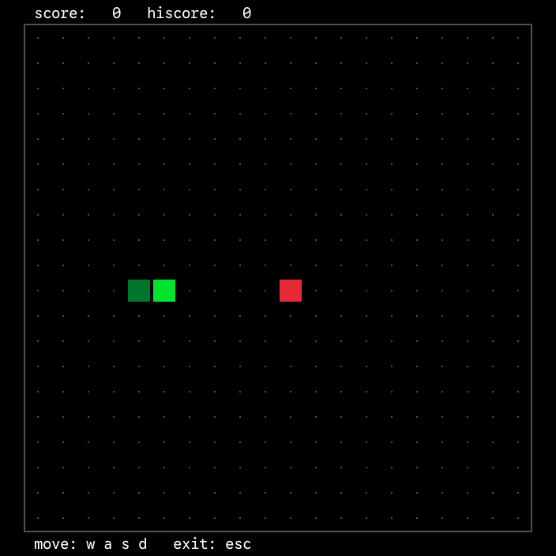

<div align="center">

## snake-gui

A graphical snake game in C using [raylib](https://github.com/raysan5/raylib)

|  |
| :-----------------------------: |

</div>

#

### How to play

1. Install and build
   [raylib](https://github.com/raysan5/raylib#build-and-installation).

2. Clone the repository:

	```bash
	git clone https://github.com/sejjy/snake-gui.git
	cd snake-gui
	```

3. Compile and run:

	```bash
	make run
	```

#

### Credits

- [snake-tui](https://github.com/sejjy/snake-tui) - A text-based snake game with
  incremental rendering, implemented in Bash and C
- [PixelCode](https://github.com/qwerasd205/PixelCode) - A pixel font designed
  to actually be good for programming
